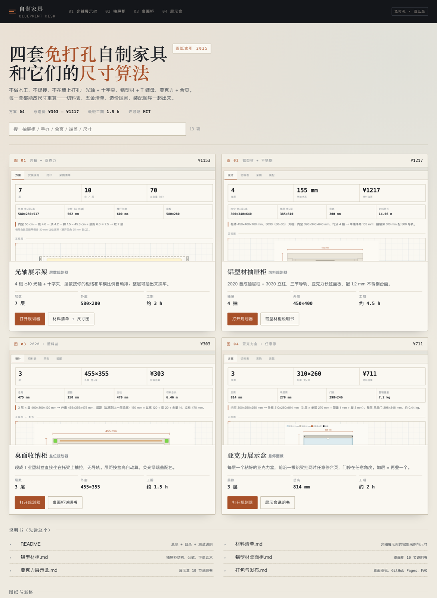

# 自制家具 · 四套方案与规划器

四套「不打孔、不焊接，一只内六角就能装完」的自制家具：**图纸 + 采购清单 + 会自己算尺寸的规划器**。
规划器是一个 Vue 3 单页应用（四个方案 + 首页），改任意尺寸实时出切料表、报价区间、正视图和装配步骤；构建产物是单个离线包，双击 `dist/index.html` 就能用，不需要联网。



| 方案 | 默认尺寸 | 容量 | 预算 | 装配时间 | 入口 |
|---|---|---|---|---|---|
| ① 光轴置物架（车模展示柜） | 600×300×500 mm | 7 层 × 10 台 = 70 台（1:64） | **¥1153**（亚克力） | 3 小时 | [规划器](https://kenneth-kun.github.io/diy-aluminum-extrusion-furniture/#/shelf) · [清单](材料清单.md) |
| ② 铝型材抽屉柜（不锈钢台面） | 450×400×760 mm | 4 抽 × 155 mm 净高 | **¥1217** | 4.5 小时 | [规划器](https://kenneth-kun.github.io/diy-aluminum-extrusion-furniture/#/cabinet) · [说明书](铝型材柜.md) |
| ③ 桌面铝型材收纳柜（盆位） | 455×355×475 mm | 3 层 × 中盆 400×300 | **¥303** | 1.5 小时 | [规划器](https://kenneth-kun.github.io/diy-aluminum-extrusion-furniture/#/tray) · [说明书](铝型材桌面柜.md) |
| ④ 亚克力展示盒（悬停面板） | 310×260×814 mm | 3 层（可叠到 6） | **¥711** | 2 小时 | [规划器](https://kenneth-kun.github.io/diy-aluminum-extrusion-furniture/#/display) · [说明书](亚克力展示盒.md) |

> 四套的共同点：结构靠**标准件互锁**（光轴十字夹 / 铝型材角码 + T 螺母 / 任意停合页），不需要台锯、不需要打孔；
> 所有尺寸都由 `floor5`（向下取整到 5 mm）决定——**宁短不长**，装不进去的永远是长的那一根。

---

## 快速开始

### 方式 1：在线版（最省事）

```
https://kenneth-kun.github.io/diy-aluminum-extrusion-furniture/
```

### 方式 2：双击离线包

```
dist/index.html     ← 构建一次后双击即可，file:// 下也能跑
```

### 方式 3：本地开发

```bash
export PATH=/path/to/node20+/bin:$PATH     # 需要 Node ≥ 20.19（Vite 7 的要求）
npm install
npm run dev        # http://127.0.0.1:5177/
```

`npm run build` 输出到 `dist/`，可直接拷给别人或丢到任意静态服务器。

### 方式 4：macOS 桌面快捷方式

```bash
bash tools/创建桌面快捷方式.command      # 生成 ~/Desktop/自制家具.app，指向 dist/index.html
```

详见 [打包与发布](打包与发布.md)。

---

## 四个规划器

### ① 光轴展示架 · 层数规划器 — 在线版 `#/shelf`

输入**车模比例**（1:64 / 1:43 / 1:24）和**你的空间或车数**，算出：

- 能放几层、每层几台、总共几台；层距、外廓、立柱长、横杆长
- 每层板尺寸（四角 35 mm 缺口、前沿 15 mm 热弯挡边）
- 材料清单（亚克力 / PETG 打印 / PETG 边框 + 片材三种做法）+ 总价 + 单件价带
- **正视图**（立柱、横杆、层板、车模、灯盒、门）+ 层数快速对比 chips
- **安装说明 10 步**（含十字夹装配示意图、验收标准）
- **打印计划**（瓦片数、耗材克数、打印小时、料钱、每片尺寸）

| 层板做法 | 总价 | 耗材/时间 | 说明 |
|---|---|---|---|
| 亚克力 5 mm 浇铸 | ¥1153 | — | 最透、最省事，让亚克力厂切好 |
| 全 PETG 打印 | ¥1004 | 1.93 kg / 175 h | 半透明磨砂（60–75% 透光），42 片瓦片 |
| PETG 边框 + 1.5 mm PET 片 | ¥979 | 1.21 kg / 110 h | 只打边框，中间夹片材，性价比最高 |

### ② 铝型材抽屉柜 — 在线版 `#/cabinet`

- 外廓 → 内空 → **抽屉净高 / 抽屉宽深**（全部向下取整到 5 mm，确保能塞进去）
- 导轨自动选型（250/300/350/400/450/500 mm 标准档，选不到会警告）
- 切料表：立柱、顶底框、抽屉前横/前竖/侧上沿，各自长度 × 数量 + 总米数
- 面板（长虹纹/透明/乳白亚克力、木板）、台面（304 不锈钢/木/无）、脚（脚轮/调节脚/无）
- 端盖三选一：**卡扣 / 自攻钉 / 螺丝款 + 端面攻丝**（自动算孔数与攻丝费）
- 13 步装配 + 采购页（每项带 1688 / 淘宝 / 京东 直达比价）

### ③ 桌面铝型材收纳柜 — 在线版 `#/tray`

- 选盆（300×200 / 400×300 / 500×350 / 600×400 或自定义）→ 自动出 2020 型材外廓
- **层距 = 盆高 + 托梁 20 + 余量 14**（取整到 5），盆顶不会顶住上一层的梁
- 顶板（琥珀色 / 透明 / 乳白亚克力 3 mm）、脚（硅胶垫 / 金属脚 / 无）、端盖颜色（荧光绿 / 黑 / 灰）
- 配色循环：砖红 → 墨绿 → 藏蓝 → 姜黄 → 中灰（对应原帖「选了 3 个颜色重一点的收纳盒」）
- 切料表 / 采购 / 装配（10 步）四个页签

### ④ 亚克力展示盒 · 悬停面板 — 在线版 `#/display`

- 每层一个粘好的亚克力盒（侧板 + 后板 + 底板），前沿压一根 2020 铝梁，**两片任意停合页**把门挂上去——推到哪里停哪里
- 层数靠叠：加层就是再放一个盒子上去，层间用 φ6 定位销对位（不用改任何结构）
- 内宽/内深/净高（cm）+ 层数 1–6 → 自动算外廓、门板、合页数、亚克力面积、切割延米
- 亚克力 3 / 5 / 8 mm、铝梁 2020 / 10×20 扁铝、门（任意停 / 阻尼 / 不装门）、顶盖、脚
- 门重与承重校核（>1.5 kg 提醒「门会自己往下溜」）、门宽超 640 mm 自动改双开
- 正视图带**开门角度**（0/35/70）+ 侧视小图，能看清「悬停」是怎么转的
- 10 步装配（含钻门孔、挂门调缝、30°/60°/90° 悬停验收）+ 六个坑 + 每项比价

---

## 再加一套方案？（一个链接就够）

这套东西的第五、第六套不需要重写工程——`skills/post-to-module/` 里存了一份完整的操作手册（skill），把「刷到一条帖子」到「系统里多一个能算能下单的模块」的十个步骤都写死了：

```
脚本抓图/抽帧 → 判读结构表 → 写内核（floor5 + 价格区间 + 关键词）
→ 画正视图 → 写 Vue 页面（四页签）→ 接路由与首页卡片
→ 补内核测试与 DOM 测试 → 写十节说明书 → 截图验收 → 构建发布
```

用法（在新会话里）：

```
把这个帖子加进系统：<帖子链接>
```

或直接加载技能：`skill post-to-module`。手册本体见 [`skills/post-to-module/SKILL.md`](skills/post-to-module/SKILL.md)，
里面有 `grab.sh`（抓小红书图文/视频）、`frames.swift`（无 ffmpeg 抽帧）、`shots.sh`（批量截图）、`ship.sh`（构建 + 推送 + gh-pages）四个脚本和内核/页面/测试的骨架模板。

---

## 目录结构

```
.
├── index.html                 Vite 入口（<div id="app">）
├── vite.config.js             构建配置（iife 单文件 + docs 静态资料插件）
├── package.json               vue 3 / vite 7
├── src/
│   ├── main.js                挂载 + 路由初始化
│   ├── App.vue                顶栏 / 路由视图 / 页脚
│   ├── router.js              hash 路由（/、/shelf、/cabinet、/tray、/display）
│   ├── styles/app.css         设计系统（制图室风格：暖纸底 + 蓝图网格 + 铜色 accent + 等宽数字）
│   ├── views/                 HomeView / ShelfView / CabinetView / TrayView / DisplayView
│   ├── components/            FieldNum、Seg、StatBar、TabsNav、BomTable、StepsList… 共 9 个
│   ├── cores/                 四个方案的计算内核（纯 JS，ESM，Node 可跑）
│   ├── draw/                  四个 SVG 正视图（shelf / cabinet / tray / display）
│   ├── lib/                   util（GBK 比价链接、剪贴板、下载）、store（localStorage）、adapt（结构归一）
│   └── data/schemes.js        首页方案卡与资料索引数据
├── tests/
│   ├── shelf.test.js          ① 内核 28 项
│   ├── cabinet.test.js        ② 内核 75 项
│   ├── tray.test.js           ③ 内核 96 项
│   ├── display.test.js        ④ 内核 120 项
│   └── run-dom-tests.sh       构建产物 DOM 冒烟测试（36 项，headless Chrome，file:// 协议）
├── public/media/              首页缩略图（thumb-*.png）与首页截图
├── dist/                      构建产物（npm run build 生成）
├── 材料清单.md / 采购清单.csv / 尺寸图.png     ① 的表格与图纸
├── 铝型材柜.md / 铝型材桌面柜.md / 亚克力展示盒.md   ②③④ 说明书
├── draw_plan.py               ① 尺寸图绘图脚本（matplotlib）
├── petg/                      ① 的 3D 打印方案（STL 生成器、瓦片、打印说明）
├── tools/                     一键打开 / 创建桌面快捷方式
└── skills/post-to-module/     「一个帖子 → 一个新模块」技能手册 + grab/frames/montage/shots/ship 脚本
```

---

## 一些实现上的取舍

- **Vue 3 单页应用 + hash 路由**：四个方案共用一个设计系统与组件库（数字输入、页签、BOM 表、步骤列表），
  路由用 `#/xxx` 而不是 History API——这样 `dist/` 丢到任意静态目录、甚至 `file://` 双击都不会 404。
- **构建成 IIFE 单文件**：Vite 默认输出 ES module，`file://` 下会被 CORS 拦掉（白屏）。
  `vite.config.js` 里把 `rollupOptions.output.format` 设成 `"iife"`、`inlineDynamicImports: true`，
  再用一个小插件把入口的 `type="module"` 改回普通 `defer` 脚本，这样双击 `dist/index.html` 能直接跑。
- **内核与视图分离**：`src/cores/*.js` 是纯函数（无 DOM、无 Vue），Node 里直接 `import` 跑回归测试；
  `src/draw/*.js` 只负责把计算结果画成 SVG 字符串。
- **所有长度向下取整到 5 mm**：宁可留 2–3 mm 缝隙，也不要因为 1 mm 塞不进整根重切。这是四套方案里唯一「不能优化」的规则。
- **SVG 用坐标映射而不是 `transform: scale(1,-1)`**：翻转坐标系会把文字镜像，所以视图里用 `X()/Y()` 两个函数把 mm 换成像素。
- **比价链接按 GBK 编码**：1688 的 `keywords` 参数按 GBK 解析，UTF-8 百分号编码会乱码。
  `src/lib/util.js` 里用 `TextDecoder('gbk')` 懒建一张汉字→双字节表，实测「光轴」→ `%B9%E2%D6%E1`。
- **打印瓦片按床尺寸切**：`petg/gen_stl.py --bed 220` 直接换床；默认 245 床下 600×300 的层板切成 3 列 × 2 行。

---

## 测试

```bash
npm test                 # 四个内核：28 + 75 + 96 + 120 = 319 项
npm run build            # 产出 dist/
npm run test:dom         # 36 项：用 headless Chrome 打开 dist/index.html（file://）逐条断言
```

DOM 测试覆盖：首页四张卡与搜索条目数、四个方案的关键数字（`580×280×517`、`390×340×640`、`455×355`、`310×260`）、
切料表话术（攻丝 / 自攻 / 卡扣三态）、BOM 比价链接、开门 35° 投影、未知路由回落首页。

---

## 关于原帖

这些结构的灵感来自小红书上的几位作者，仓库里**只放自己重新绘制的示意图和计算脚本**，原帖照片不随仓库分发：

- 光轴置物架：<https://www.xiaohongshu.com/explore/6afef742000000002b0047c5>
- 铝型材抽屉柜：<https://www.xiaohongshu.com/explore/69048a63000000000703402b>
- 亚克力展示盒（悬停面板）：<https://www.xiaohongshu.com/explore/6b057827000000002b01df5a>

价格是 2025 年的手工估算区间（1688/淘宝散买），不是实时成交价；下单前请以商家报价为准。

---

## 许可

代码与文档：[MIT](LICENSE)。图纸可以随便改、随便商用，出问题别找我 🙂
DIY 有风险：高层柜体请务必做防倾倒固定，切割/攻丝请戴护目镜。