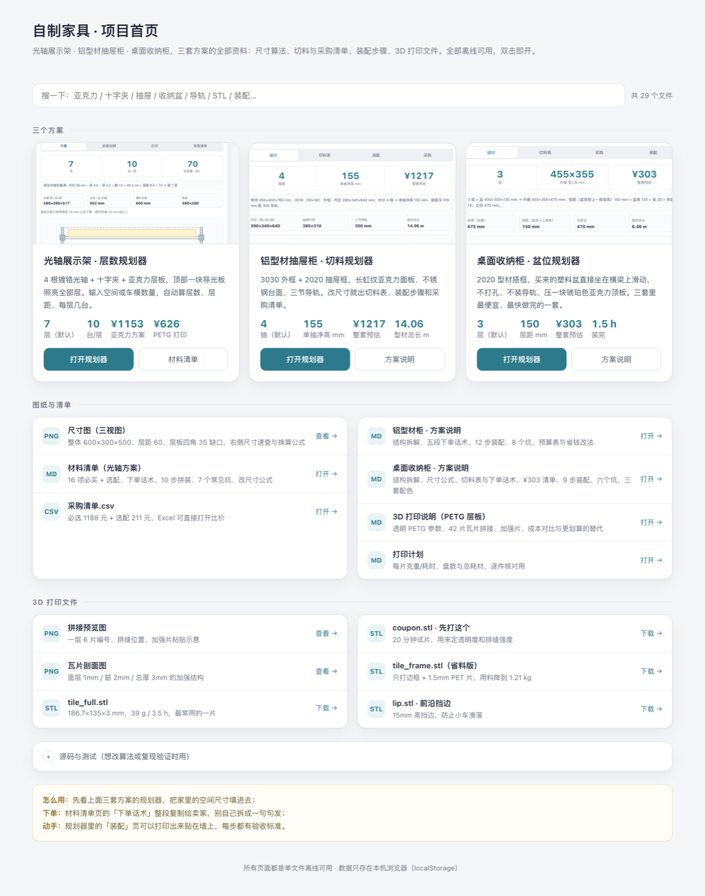

# 自制家具 · 三套方案与规划器

三套「不打孔、不焊接，一只内六角就能装完」的自制家具：**完整图纸 + 采购清单 + 会自己算尺寸的网页规划器**。
全部纯前端、离线可用、零依赖，双击 `index.html` 就能跑。



| 方案 | 默认尺寸 | 容量 | 预算 | 装配时间 | 入口 |
|---|---|---|---|---|---|
| ① 光轴置物架（车模展示柜） | 600×300×500 mm | 7 层 × 10 台 = 70 台（1:64） | **¥1153**（亚克力） | 1 天 | [规划器](planner/index.html) · [清单](材料清单.md) |
| ② 铝型材抽屉柜（不锈钢台面） | 450×400×760 mm | 4 抽 × 155 mm 净高 | **¥1217** | 1 天 | [规划器](planner/cabinet.html) · [说明书](铝型材柜.md) |
| ③ 桌面铝型材收纳柜（盆位） | 455×355×475 mm | 3 层 × 中盆 400×300 | **¥303** | 1.5 小时 | [规划器](planner/tray.html) · [说明书](铝型材桌面柜.md) |

> 三套的共同点：结构靠**标准件互锁**（光轴十字夹 / 铝型材角码 + T 螺母），不需要台锯、不需要打孔；
> 所有尺寸都由 `floor5`（向下取整到 5 mm）决定——**宁短不长**，装不进去的永远是长的那一根。

---

## 快速开始

### 方式 1：直接双击（最省事）

```
index.html          ← 双击，浏览器打开项目首页
```

所有页面都是普通的 `file://` 静态页，双击即可，不需要装任何东西、不需要联网。

### 方式 2：本地起个静态服务（推荐，复制链接、截图更稳）

```bash
cd diy-furniture-planner   # 或你 clone 下来的目录名
python3 -m http.server 8000
# 打开 http://localhost:8000/
```

### 方式 3：macOS 桌面快捷方式

双击项目根目录的 `打开项目首页.command`，或把 `tools/自制家具.app` 拖到桌面（见 [打包与发布](打包与发布.md)）。

---

## 三个规划器

### ① 光轴置物架 · 车模层数规划器 — [planner/index.html](planner/index.html)

输入**车模比例**（1:64 / 1:43 / 1:24）和**你的空间或车数**，算出：

- 能放几层、每层几台、总共几台；层距、外廓、立柱长、横杆长
- 每层板尺寸（四角 35 mm 缺口、前沿 15 mm 热弯挡边）
- 材料清单（亚克力 / PETG 打印 / PETG 边框 + 片材三种做法）+ 总价 + 单件价带
- **正视图**（立柱、横杆、层板、车模、灯盒、门）
- **安装说明 10 步**（含验收标准，可一键打印成 A4）
- **打印计划**（瓦片数、耗材克数、打印小时、料钱、每片尺寸）

有三种层板做法：

| 层板做法 | 总价 | 耗材/时间 | 说明 |
|---|---|---|---|
| 亚克力 5 mm 浇铸 | ¥1153 | — | 最透、最省事，让亚克力厂切好 |
| 全 PETG 打印 | ¥1004 | 1.93 kg / 175 h | 半透明磨砂（60–75% 透光），42 片瓦片 |
| PETG 边框 + 1.5 mm PET 片 | ¥979 | 1.21 kg / 110 h | 只打边框，中间夹片材，性价比最高 |

### ② 铝型材抽屉柜 — [planner/cabinet.html](planner/cabinet.html)

- 外廓 → 内空 → **抽屉净高 / 抽屉宽深**（全部向下取整到 5 mm，确保能塞进去）
- 导轨自动选型（250/300/350/400/450/500 mm 标准档，选不到会警告）
- 切料表：立柱、顶底框、抽屉前横/前竖/侧上沿，各自长度 × 数量 + 总米数
- 面板（长虹纹/透明/乳白亚克力、木板）、台面（304 不锈钢/木/无）、脚（脚轮/调节脚/无）
- 端盖三选一：**卡扣 / 自攻钉 / 螺丝款 + 端面攻丝**（自动算孔数与攻丝费）
- 13 步装配 + 采购页（每项带 1688 / 淘宝 / 京东 直达比价）

### ③ 桌面铝型材收纳柜 — [planner/tray.html](planner/tray.html)

- 选盆（300×200 / 400×300 / 500×350 / 600×400 或自定义）→ 自动出 2020 型材外廓
- **层距 = 盆高 + 托梁 20 + 余量 14**（取整到 5），盆顶不会顶住上一层的梁
- 顶板（琥珀色 / 透明 / 乳白亚克力 3 mm）、脚（硅胶垫 / 金属脚 / 无）、端盖颜色（荧光绿 / 黑 / 灰）
- 配色循环：砖红 → 墨绿 → 藏蓝 → 姜黄 → 中灰（对应原帖"选了 3 个颜色重一点的收纳盒"）
- 切料表 / 采购 / 装配（10 步）四个页签，支持打印

---

## 目录结构

```
.
├── index.html                项目首页（搜索 + 三个方案入口）
├── hub-preview.png           首页截图
├── 材料清单.md               ① 光轴置物架：结构拆解、下单话术、拼装步骤、常见坑
├── 采购清单.csv              ① 可直接给商家看的采购表（UTF-8 BOM，Excel 能开）
├── 尺寸图.png                ① 三视图 + 尺寸速查
├── draw_plan.py              ① 尺寸图绘图脚本（matplotlib）
├── 铝型材柜.md               ② 抽屉柜：拆解、公式、话术、装配、坑、预算
├── 铝型材桌面柜.md           ③ 桌面柜：同上（含端盖三选一与配色）
├── planner/                  三个规划器（纯静态，UMD 内核 + 单页 UI）
│   ├── index.html            ① 光轴置物架（方案/安装说明/打印/采购清单 四页签）
│   ├── planner-core.js       ① 内核：尺寸、BOM、打印计划、装配步骤
│   ├── cabinet.html          ② 抽屉柜（设计/切料/装配/采购）
│   ├── cabinet-core.js       ② 内核
│   ├── tray.html             ③ 桌面柜（设计/切料/采购/装配）
│   ├── tray-core.js          ③ 内核
│   ├── cabinet.css           三个页面共用的样式
│   ├── *-test.js             内核回归测试（node，无依赖）
│   ├── *-dom-test.sh         浏览器渲染回归（headless Chrome）
│   └── preview*.png          截图
└── petg/                     ① 的 3D 打印方案
    ├── gen_stl.py            STL 生成器（numpy 手写二进制 STL，可换床尺寸）
    ├── stl/                  瓦片 / 边框 / 挡边 / 加强片 / 试片 + 打印计划
    ├── 打印说明.md           参数、顺序、拼装、成本对比、常见问题
    ├── render_preview.py     工程示意图
    └── bambu_bridge.py       拓竹打印机直连实验（发现 / 状态 / 上传 / 打印）
```

---

## 一些实现上的取舍

- **纯静态、零依赖**：三个内核都是 UMD（`window.XxxCore` / `module.exports`），页面直接 `<script src>` 引入，node 里 `require` 就能跑测试。没有构建步骤，改完刷新即可。
- **所有长度向下取整到 5 mm**：宁可留 2–3 mm 缝隙，也不要因为 1 mm 塞不进整根重切。这是三套方案里唯一"不能优化"的规则。
- **SVG 用坐标映射而不是 `transform: scale(1,-1)`**：翻转坐标系会把文字镜像，所以视图里用 `X()/Y()` 两个函数把 mm 换成像素。
- **比价链接按 GBK 编码**：1688 的 `keywords` 参数按 GBK 解析，UTF-8 百分号编码会乱码。页面里内置了一张字符→GBK 十六进制表（`TextDecoder('gbk')` 懒构建），实测「光轴」→ `%B9%E2%D6%E1`。
- **打印瓦片按床尺寸切**：`gen_stl.py --bed 220` 直接换床；默认 245 床下 600×300 的层板切成 3 列 × 2 行 = 6 片，42 片打满 7 层。

---

## 测试

全部无依赖，本地直接跑：

```bash
cd planner
node test-interaction.js      # ① 光轴规划器内核
node cabinet-test.js          # ② 抽屉柜内核（75 项）
node tray-test.js             # ③ 桌面柜内核（96 项）
bash cabinet-dom-test.sh      # ② 浏览器渲染（28 项，需 Chrome）
bash tray-dom-test.sh         # ③ 浏览器渲染（45 项，需 Chrome）
```

DOM 测试用 `chrome --headless=new --dump-dom` + grep 断言，覆盖页签切换、步骤数、BOM 行、比价链接、URL 参数。

---

## 关于原帖

这两个结构的灵感来自小红书上的两位作者，仓库里**只放自己重新绘制的示意图和计算脚本**，原帖照片不随仓库分发：

- 光轴置物架：<https://www.xiaohongshu.com/explore/6afef742000000002b0047c5>
- 桌面铝型材收纳柜（新配色）：<https://www.xiaohongshu.com/explore/69048a63000000000703402b>

价格是 2025 年的手工估算区间（1688/淘宝散买），不是实时成交价；下单前请以商家报价为准。

---

## 许可

代码与文档：[MIT](LICENSE)。图纸可以随便改、随便商用，出问题别找我 🙂
DIY 有风险：高层柜体请务必做防倾倒固定，切割/攻丝请戴护目镜。