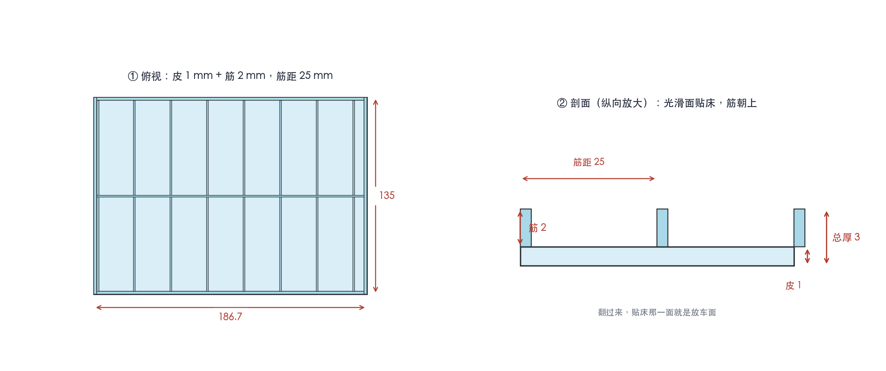
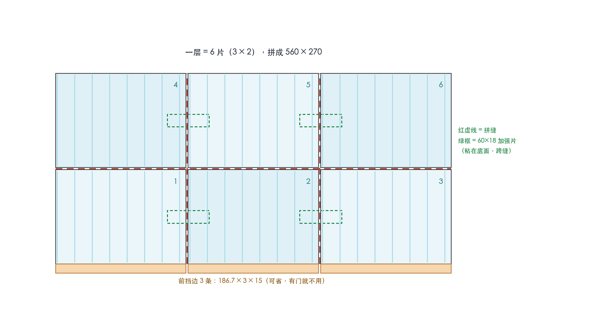
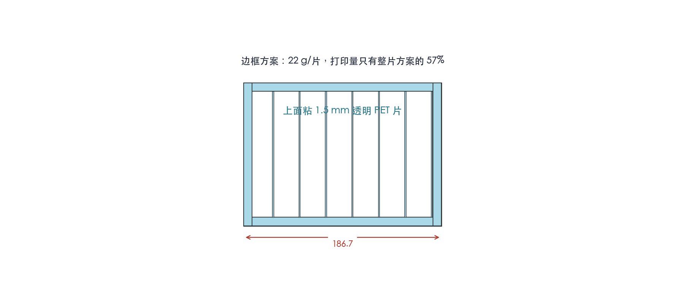

# PETG 打印层板 · 文件与打印说明

> 这页是详细版。规划器里已经集成：把「层板材料」切成 PETG，会按你选的层数自动算片数、克数、时间，
> 并在「打印」标签页里给出切片参数和 STL 下载。

> 结论先说：**能做，但透明度和时间要打折扣。**
> 打印出来的透明 PETG 是「磨砂半透明」，不是亚克力的水晶透；7 层全部打印约 **1.95 kg 料 / 177 小时**，
> 比亚克力省 100 多元，但要多花一周机器时间。文末有两种更划算的替代。

---

## 1. 文件清单（已生成，可直接切片）

都在 [`stl/`](stl/) 目录里，单位 mm，二进制 STL，无需修复。

| 文件 | 尺寸 | 单片 | 每层数量 | 7 层数量 |
|---|---|---|---|---|
| `tile_full.stl` | 186.7 × 135.0 × 3.0 | 39.0 g / 3.5 h | 6 | **42** |
| `tile_frame.stl`（替代方案） | 186.7 × 135.0 × 3.0 | 22.4 g / 2.0 h | 6 | 42 |
| `lip.stl` | 186.7 × 3 × 15 | 10.7 g / 1.0 h | 3 | 21 |
| `splice.stl` | 60 × 18 × 1.8 | 2.5 g / 0.2 h | 4 | 28 |
| `coupon.stl` | 40 × 40 | 2.2 g / 0.2 h | — | 先打 1 个试 |

> ⚠️ **一盘只能放 1 片**：186.7 mm 超过 256 床的一半，所以 42 片 = **42 盘**，
> 每盘还要加上上料、等冷却取件的时间（约 10 分钟），实际排产按 42 盘算。

**为什么是 186.7 × 135**：层板按 560 × 270 设计（比外框 580 × 280 各内缩 10 mm，避开四根立柱，
所以打印版**不需要**亚克力那种四角缺口），256 热床能放 3 列 × 2 行。

> 热床不是 256？重新生成即可，脚本会自己重算行列：
> `python3 gen_stl.py --bed 220`（220 热床）、`--shelf 560x270`、`--th 3`。

## 2. 透明 PETG 参数（关键就 5 条）

| 参数 | 值 | 为什么 |
|---|---|---|
| **先烘干** | 65 °C × 4 h | PETG 吸潮，没烘干 = 满片气泡、发白，这是透明度第一杀手 |
| 层高 | 0.10 mm（0.08 更透，0.16 是分界线） | 层纹就是雾度来源 |
| 温度 | 喷嘴 245–255 °C / 热床 80 °C | 温度越高层间融合越好，越透 |
| **流量** | **108–118 %** | 轻微过挤，把层间空气挤出去——这是透明打印的核心技巧 |
| 速度 | 外墙 25–35 / 内墙 40 / 填充 50 mm/s | 慢，给融合时间 |
| 填充 | **100 %**（直线或同心） | 有空腔就发白 |
| 风扇 | 0–20 %（几乎关） | 快冷会让层间不融 |
| 支撑 | **不需要** | 全部是大平面朝下 + 竖直筋 |
| 底板 | 光面 PEI（不要纹理板）+ 5 mm brim | 纹理板会在放车面留花纹 |
| 取件 | **完全冷却**再取，别硬撬 | 热取会变形、留白印 |

打印方向：**光滑面贴床、筋朝上**。成品翻过来，贴床那一面就是放车面（最平、最透）。
所以顶面熨烫（ironing）在这里没用，不用开。

## 3. 建议的开工顺序

1. 打 1 个 `coupon.stl`，调流量/温度，直到对着光看**字能认出来**（能看到“半透明”就算成功）。
2. 打 1 片 `tile_full.stl`，量厚度（应为 3.0 ±0.1），检查有没有翘边。
3. 拼一层（6 片 + 加强片）试装到架子上，确认 560 × 270 刚好落在两根光轴之间。
4. 没问题再批量：42 片排满 7 层。

## 4. 拼装

- 6 片按 3 × 2 摆好，接缝对齐；底面跨缝贴 `splice.stl` 加强片（每道竖缝 2 片、横缝 3 片）。
- 粘接用 **502 + 促进剂**（最快），或 3M DP8005 结构胶（最稳）；PETG 用氯仿效果一般。
- 接缝可以先用砂纸把边缘打毛再粘，强度更高。
- 前挡边 `lip.stl` 可粘可不粘：有前门就不用，没有门建议粘，防止车滑落。
- 拼好的整片直接放在原来的两根横光轴上，不需要任何螺丝。

## 5. 成本 / 时间对比

| 方案 | 材料费 | 机器时间 | 透明度 | 备注 |
|---|---|---|---|---|
| 5 mm 亚克力激光切割 ×7 | ≈ 260 元 | 1–3 天（外发） | 92 %，水晶透 | 最省事、最好看 |
| **PETG 全打印 ×42** | 1.95 kg ≈ 126 元 | **≈ 177 h** | 60–75 %，磨砂半透明 | 有接缝，会吸灰 |
| **PETG 边框 ×42 + 1.5 mm 透明 PET 片** | 1.23 kg ≈ 80 元 + 片材 ~20 元 | ≈ 112 h | 80 %，接近亚克力 | 打印量只有 57 %，接缝更少 |

> 时间按 0.1 mm 层高、慢速、100 % 填充估算（约 11 g/h）。换 0.2 mm 层高能快 2/3，但会明显更雾。

## 6. 如果你只想省事：两个更划算的替代

1. **只打“边框 + 筋”，板面买 1.5 mm 透明 PET 片**（文具店/建材店 10–20 元/㎡ 那种）。
   打印量减半，透明度和平整度都比全打印好，接缝也更少。
2. **只打小件**：把 32 个铝合金十字夹换成打印件（约 197 元 → 15 元），层板还是买亚克力。
   但 PETG 会蠕变，夹紧力不如铝件，只建议用在轻载的展示架上。

## 7. 常见问题

| 现象 | 原因 | 处理 |
|---|---|---|
| 整片乳白不透明 | 料没烘干 / 温度低 / 流量不足 | 烘干 4 h，喷嘴 +10 °C，流量 +8 % |
| 出现白色结晶纹 | 冷却太快 | 关风扇、加挡风罩 |
| 四角翘起 | 热床温度低 / 无 brim | 80 °C + 5 mm brim + 打完别马上开门 |
| 接缝明显发亮 | 胶溢出 | 胶量少一点，粘完用 2000 目砂纸修 |
| 表面有指纹印 | PETG 表面易留印 | 戴手套操作，脏了用酒精擦 |

> 想更透：2000 目水砂 + 抛光膏（半小时/片），或者二氯甲烷蒸汽熏（**危险，必须通风、戴丁腈手套**，不建议新手）。

---

生成脚本：[gen_stl.py](gen_stl.py)（改参数即出新的 STL）· 示意图脚本：[render_preview.py](render_preview.py)
