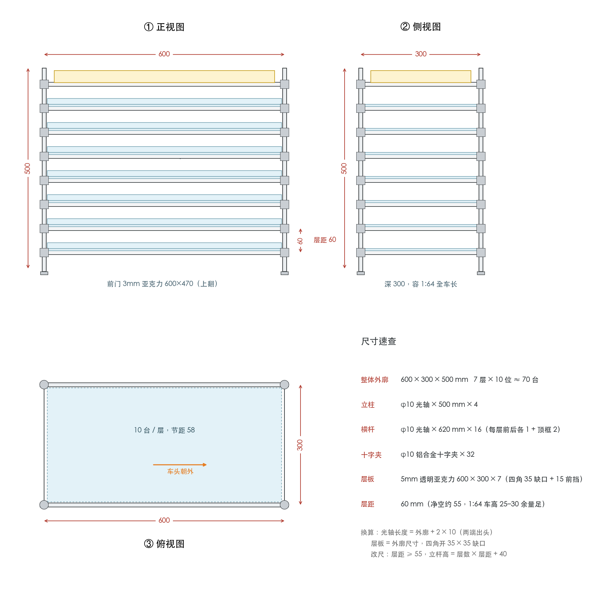

# 光轴多层展示架 · 采购清单与拼装方案

> 参考对象：小红书「DIY纯手搓｜光轴置物架」7 层 × 10 车位、1:64 车模展示架。
> 本方案把它拆成可下单的零件清单：**整体 600 × 300 × 500 mm，7 层，每层 10 台 ≈ 70 台**。
> 所有价格为 2025 年前后淘宝/1688 常见区间，**仅作预算参考**，实际以店铺报价为准。
>
> 🧮 不想自己算？用交互版：[层数规划器](planner/index.html)（填空间或车数，自动出层数 + 清单 + 报价）。
>
> 🔎 每条材料都带 **1688 / 淘宝 / 京东 搜同款直达链接 + 单件价带**，关键词按你的实际规格生成（不是"光轴"这种大词）。



---

## 0. 先说清楚它是什么结构

原帖的架子=**光轴（镀铬直线轴）当骨架 + 铝合金十字夹当节点 + 亚克力当层板/门 + 顶部一个灯盒打全场光**。

```
        顶框横杆 ──┬──────────────┬── 灯盒（导光板，照亮 7 层）
                   │              │
   立柱 φ10 ───────┤   亚克力层板  ├─────── 立柱 φ10
        （4 根）    │   （每层 1 片）│        （4 根）
                   │              │
      底板（8mm 亚克力）┴──────────────┴── 硅胶脚垫找平
```

- **竖的 4 根光轴**：决定层高，不打孔、不焊接，全靠夹子锁紧 → 这是它"纯手搓"的关键。
- **每层前后 2 根横光轴**：托住亚克力层板，同时把 4 根立柱连成刚性框架。
- **十字夹**：一根夹竖杆、一根夹横杆，内六角顶丝锁死；位置可任意调，装错了松开重来。
- **亚克力层板**：四角开缺口卡在立柱内侧，前面热弯一道挡边防止车滑落。
- **灯盒**：只有顶部一个光源，靠导光板把光打散往下铺，所以 7 层都能亮。

---

## 1. 核心采购清单（必买）

| # | 品名（淘宝搜索词） | 规格 | 数量 | 参考单价 | 小计 | 备注 |
|---|---|---|---|---|---|---|
| 1 | **镀铬光轴 / 直线光轴**（φ10） | φ10 × 500 mm | 4 根 | 8–12 元 | ~40 | 立柱；要求切齐、两端倒角去毛刺 |
| 2 | 镀铬光轴（同上） | φ10 × 620 mm | 16 根 | 9–13 元 | ~180 | 7 层 × 前后 2 根 + 顶框 2 根 |
| 3 | **铝合金光轴十字夹**（同径 φ10） | 夹 φ10 × φ10，带内六角顶丝 | 32 个 | 4–8 元 | ~190 | 4 角 × (7 层 + 顶框) = 32；**多买 4 个备用** |
| 4 | **圆法兰光轴固定座**（SHF10） | 内孔 φ10，4 孔法兰 | 4 个 | 6–10 元 | ~32 | 立柱落地生根，锁在底板上 |
| 5 | **亚克力层板（定制）** | 5 mm 透明**浇铸**板，600 × 300，四角 35×35 缺口，前沿热弯 90°/高 15 | 7 片 | 30–45 元 | ~260 | 最关键的一笔，见 4.1 下单话术 |
| 6 | **亚克力底板（定制）** | 8 mm 透明板，620 × 320，四角 R10 | 1 片 | 60–90 元 | ~75 | 承重+稳定；孔位建议现场配钻 |
| 7 | **亚克力前门（定制）** | 3 mm 透明板，600 × 470 | 1 片 | 60–90 元 | ~75 | 上翻式；也可做左右对开门 |
| 8 | **亚克力合页**（透明） | 小号，2 个/套 | 1 套 | 20–35 元 | ~28 | 也可用"亚克力铰链+亚克力胶"自制 |
| 9 | **磁吸 / 圆形强磁** | φ6–8 mm，带胶套 | 1 套（2 组） | 10–20 元 | ~15 | 门关上不晃 |
| 10 | **导光板灯箱（定制）** | 550 × 240 × 20 mm，12 V，侧发光 | 1 个 | 120–200 元 | ~160 | 原帖"一个灯盒"的核心；见第 4 节 |
| 11 | **12 V 电源适配器** | 12 V / 2 A，DC 头 | 1 个 | 20–35 元 | ~28 | 灯箱一般不带电源 |
| 12 | **触摸/旋钮调光开关** | 12 V 在线式 | 1 个 | 15–25 元 | ~20 | 7 层全亮容易过曝，能调很重要 |
| 13 | **硅胶脚垫 / M6 调节脚** | φ25 自粘 或 M6×10 | 4 个 | 2–5 元 | ~12 | 找平 + 防滑 |
| 14 | **亚克力专用胶**（氯仿/二氯甲烷） | 小瓶 + 注射器针头 | 1 套 | 15–25 元 | ~20 | 粘挡边/侧板/背板 |
| 15 | **螺丝配件包** | M4×8/12 内六角 + 弹垫 + 螺母 | 1 包 | 20–40 元 | ~30 | 十字夹常自带，补一点备用 |
| 16 | **内六角扳手套装** | 1.5/2/2.5/3 mm | 1 套 | 15–30 元 | ~25 | 十字夹多为 2.5 或 3 mm |
| | **合计（必买）** | | | | **≈ 1 190 元** | 常在 900–1 300 之间浮动；选配全加 ≈ +210 |

> 🖨 **有 3D 打印机？层板可以自己打。** 规划器左侧把「层板材料」切成 PETG，
> 清单会换成耗材、并多出一个「打印」标签页（片数/克数/小时/切片参数/STL 下载）。
> 详细参数见 [PETG 打印说明](petg/打印说明.md)：6 片/层拼 560×270，约 1.93 kg、175 小时。

## 2. 选配（按需加，不影响能拼起来）

| 品名 | 规格 | 数量 | 参考价 | 作用 |
|---|---|---|---|---|
| 亚克力背板 | 3 mm，600 × 490 | 1 | 70–90 元 | 防尘、挡墙、藏线 |
| 亚克力侧板 | 3 mm，300 × 490 | 2 | 80–110 元 | 防尘；也让整体更"盒子" |
| 光轴限位环（固定环） | φ10 | 8–14 个 | 2 元/个 | 层板左右定位微调 |
| 3M VHB 双面胶 | 12 mm 宽 | 1 卷 | 15 元 | 粘灯箱、粘脚垫 |
| 亚克力抛光膏 | — | 1 | 20 元 | 切口发白时救场 |
| 防倾倒固定件 | L 型角码 + 膨胀螺丝 | 1 套 | 10 元 | 放高柜上必装 |

## 3. 省钱的两种降配（能压到 600–800 元）

1. **把 φ10 换成 φ8**：光轴、十字夹、固定座全线便宜约 30%，1:64 车模展示完全够用（单层承重 <1 kg）。
2. **灯箱换成 LED 铝槽灯条**：550 mm 高显色灯条 + 乳白亚克力扩散板 + 铝槽 ≈ 60–90 元，效果 80 分，但光斑会比导光板明显一点。
3. 层板 5 mm 不要降：降到 3 mm 会明显下垂、且热弯容易发白。

---

## 4. 给卖家的下单话术（直接复制）

### 4.1 亚克力（定制切割店）

```
你好，做一套车模展示架的亚克力件，材料要 5mm 透明浇铸板（不要挤出板），
要求激光切割、边缘抛光、无划痕，带保护膜发货。

A. 层板 ×7：外形 600 × 300 mm，四角各开 35 × 35 mm 直角缺口；
   前沿热弯 90°，挡边高 15 mm，内 R2；
   弯好后不能有发白/裂纹。
B. 底板 ×1：8mm 透明板，620 × 320 mm，四角 R10，不预打孔。
C. 前门 ×1：3mm 透明板，600 × 470 mm，四周抛光。
（可选）背板 3mm 600 × 490 ×1，侧板 3mm 300 × 490 ×2。

数量少，可接受 3–5 天工期。缺口尺寸公差 ±0.3mm，板面公差 ±0.5mm。
```

> 关键点：**浇铸板**（cast）比挤出板（extruded）抗应力开裂；热弯件一定要**退火**，否则装螺丝就裂。

### 4.2 光轴（五金/直线传动店）

```
镀铬直线光轴 φ10，材质 GCr15 镀硬铬，公差 h7，表面无锈无划伤：
φ10 × 500 mm × 4 根
φ10 × 620 mm × 16 根
请按尺寸切割、两端倒角去毛刺，同批次发货，每根单独包好防磕碰。
```

> 别买"不锈钢圆棒"：公差松、容易弯、表面一划就花。要"直线光轴/镀铬光轴"。

### 4.3 十字夹

搜「光轴十字夹 φ10 铝合金」或「光轴交叉固定夹 同径」。
确认是**同径 φ10 × φ10**、带**内六角紧定螺钉**，不是"异径"或"单孔夹"。

---

## 5. 拼装步骤（约 2–3 小时，1 人可完成）

> 这一节是简版。**完整版带验收标准、会随层数自动改数字**的版本在规划器的「安装说明」标签页里，
> 可以一键「打印 / 存为 PDF」带到工作台上。

1. **拆包点数**：光轴按 500/620 分两堆，十字夹数 32 个，层板 7 片对缺口。
2. **立底框**：4 个 SHF10 固定座先松松装在底板上（先别锁死）。
3. **插立柱**：4 根 500 光轴插进固定座，用直角尺找正，锁紧顶丝。
4. **装第一层**：在 40 mm 高度套 4 个十字夹，穿前后两根 620 横杆，**只轻轻锁**。
5. **放层板**：缺口对准立柱放下去，检查四周缝隙是否均匀（这是后面所有层的位置基准）。
6. **逐层往上**：按 60 mm 层距重复 4–5，共 7 层；最后在 460 mm 装顶框两根横杆。
7. **整体校方**：量两条对角线（600 × 300 的对角 ≈ 670.8），差 >2 mm 就松开重调；然后**全部锁死**。
8. **装灯**：灯箱用 VHB 贴在顶框下方（或两侧角码固定），电源线从背板后面走，装调光开关。
9. **装门**：合页固定在顶框，磁吸在底框；调门缝，保证开合不刮层板。
10. **通电测试**：每层都照亮、无频闪；把车摆上去，检查层距够不够（SUV/卡车模型要单独留一层）。

---

## 6. 最容易踩的 7 个坑

| 坑 | 后果 | 对策 |
|---|---|---|
| 买了挤出板亚克力 | 装螺丝/热弯后开裂、发白 | 只买**浇铸板**，热弯件要求退火 |
| 光轴公差松（买了圆棒） | 十字夹夹不紧、架子会晃 | 认准"直线光轴 h7"，到货用卡尺量 |
| 十字夹买成异径/单孔 | 装不上 | 下单前问清"同径 φ10×φ10" |
| 亚克力孔位自己打歪 | 板裂、报废 | 底板孔位**按实物配钻**，用 4 mm 钻头慢速+垫木板 |
| 灯太暗/太刺眼 | 下层发黑 or 反光刺眼 | 选 4000 K、Ra>90、可调光；灯箱离最上层留 40 mm |
| 层距做 50 mm | 高一点的 SUV/皮卡放不进 | 层距 ≥55，最好 60；或留一层 75 |
| 直接放高处不固定 | 倾倒 | 8 kg 左右的架子，靠墙 + L 角码固定 |

---

## 7. 怎么改成你自己的尺寸

```
层距 P（≥55，建议 60）
立柱长 L = 层数 N × P + 40
横杆长 = 外宽 W + 20
层板  = W × D，四角开 35 × 35 缺口
亚克力跨宽 W 建议 ≤ 700，超过要加中间立柱
```

- 每层想放 8 台 → 宽度按 58/台 折算：W ≈ 8 × 58 + 20 ≈ 480。
- 想放 1:43 车模 → 层距改 90，深度改 380。
- 想做上墙款 → 去掉底板，立柱换成"光轴 + 墙面固定座"，但一定要打进墙体承重件。

---

## 8. 想先练手？

如果这 1153 元 / 1 天有点重，先做同系列的 [桌面收纳柜](铝型材桌面柜.md)：2020 型材 + 塑料盆，¥303、1.5 小时装完，不打孔不用导轨，做完再上这套。

## 9. 参考

- 原帖：[DIY纯手搓｜光轴置物架（Black Collector，小红书）](https://www.xiaohongshu.com/explore/6afef742000000002b0047c5)
- 亚克力板材/加工价格区间：[亚克力板加工价格（亿方新材料）](https://www.zjyifa.com/news/acrylic/1208.html)
- 光轴 DIY 配件（光轴杆/固定环/固定座/十字夹）：[1688 光轴DIY置物架配件](https://detail.1688.com/offer/973241727331.html)
- 同类 DIY 参考：[光轴亚克力置物架](https://www.xiaohongshu.com/discovery/item/68d64f6c0000000013004f48)

> 价格均为估算；建议先买「1 层」的材料做小样试装（约 80 元），确认孔径、缺口、夹子手感后再下整套单。
